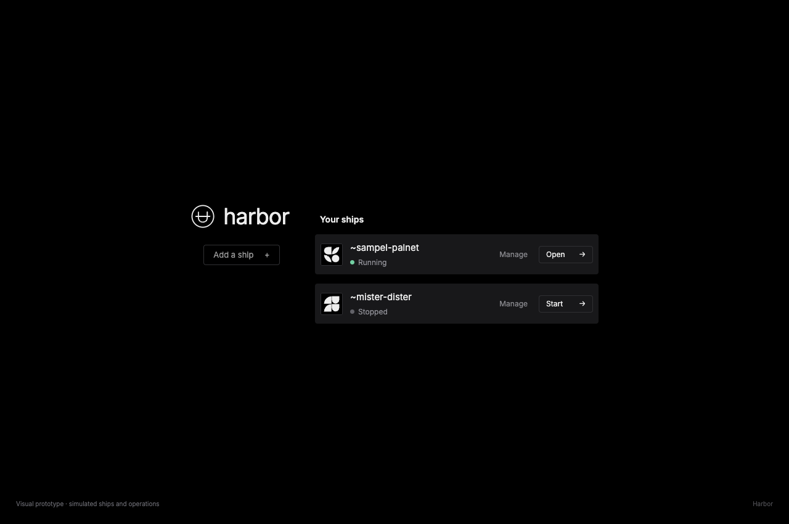

# Harbor

[](https://github.com/davetist/harbor/actions/workflows/ci.yml)

Harbor is an open-source, self-hosted Urbit ship runner for **macOS and Linux, on x86_64 and ARM64**. It aims to bring [Port](https://github.com/latter-bolden/port)'s simple, elegant approach back to life: easy onboarding, a quiet interface, and practical tools for looking after your ships.

A native Go service runs your ships. You manage them in a browser; closing the browser leaves them running. The interface uses upstream Urbit sigils and keeps maintenance, runtime updates, recovery and the Dojo within reach.



*Visual preview with simulated ships; native validation is documented separately.*

**Experimental alpha.** Native lifecycle testing has passed on Apple Silicon and a Raspberry Pi 4. Fresh comet boot/login is verified on both ARM64 targets. Intel execution, valid identity-key onboarding/migration, physical external-drive failures and the newly observed Pi replay restart failure remain open. Use disposable ships while these acceptance gates are unfinished. See [validation](docs/validation.md) and [release readiness](docs/release-readiness.md).

## Start Harbor

From a source checkout, install Go 1.27.2 or newer and Node 24.x, then run:

```sh
git clone https://github.com/davetist/harbor.git
cd harbor
npm --prefix web ci
HARBOR_GO=go scripts/build.sh
./dist/harbor serve
```

Open **http://127.0.0.1:18789** on that computer, or **http://HOST-IP:18789** from another device on your trusted LAN or tailnet. Harbor opens **Your ships** when ships exist, and onboarding when the registry is empty. Installed binary packages need neither Node nor a database daemon.

Choose **Start with a key**, **Try a comet**, or **Use an existing pier**. Existing folders belong to the computer running Harbor; uploaded files come from your browser's computer. Stop an existing ship in its previous runner before registering it.

The default Harbor listener is IPv4 `0.0.0.0:18789`; ship HTTP ports start at 8080. Harbor validates Host and browser origins without filtering clients or interfaces by IP range. **There is no separate Harbor login: clients that can reach the control interface can control all ships.** Use a trusted LAN and external firewall or tailnet access rules; see [network configuration](docs/installation.md#network-access). Do not forward these ports publicly.

## What it does

- Boot from a key, create a comet, register a stopped existing pier, or restore a full Harbor archive.
- Start and stop ships, open their web interface, retrieve an access code, and use the Dojo.
- Run Pack, Meld, Roll and Chop, with editable schedules and resource checks.
- Export a verified full pier, update the native runtime, replay, and retain interrupted-work recovery holds.
- Use a mounted external drive, with filesystem identity checks before startup.
- Run as a per-user macOS LaunchAgent or Linux systemd service.

Automatic maintenance starts enabled on the measured hardware/runtime/loom profiles; other profiles start paused with an explanation. Existing schedules keep their settings. See [maintenance](docs/maintenance.md).

Tailscale, mounting/formatting drives, certificates and network policy remain external. Harbor does not configure them.

## Documentation

- [Installation, services and configuration](docs/installation.md)
- [Onboarding, loom size and migration](docs/onboarding.md)
- [Maintenance defaults and resource checks](docs/maintenance.md)
- [External storage](docs/external-storage.md)
- [Retained uploads and export cleanup](docs/retention.md)
- [Native acceptance trials](docs/native-acceptance.md)
- [Signed macOS distribution](docs/macos-signing.md)
- [Architecture](docs/architecture.md)
- [LMDB mapping workaround, evidence and retirement criteria](docs/lmdb-mapping-workaround.md)
- [Validation and remaining acceptance gates](docs/validation.md)
- [Publication audit and release procedure](docs/release-readiness.md)
- [Contributing](CONTRIBUTING.md) · [Security policy](SECURITY.md) · [Changelog](CHANGELOG.md)

Report reproducible problems in [GitHub issues](https://github.com/davetist/harbor/issues). Report security vulnerabilities privately using the [security policy](SECURITY.md).

## License

Harbor is licensed under [MIT](LICENSE). Distributions include third-party license notices. The separately downloaded Urbit runtime retains its upstream license.
